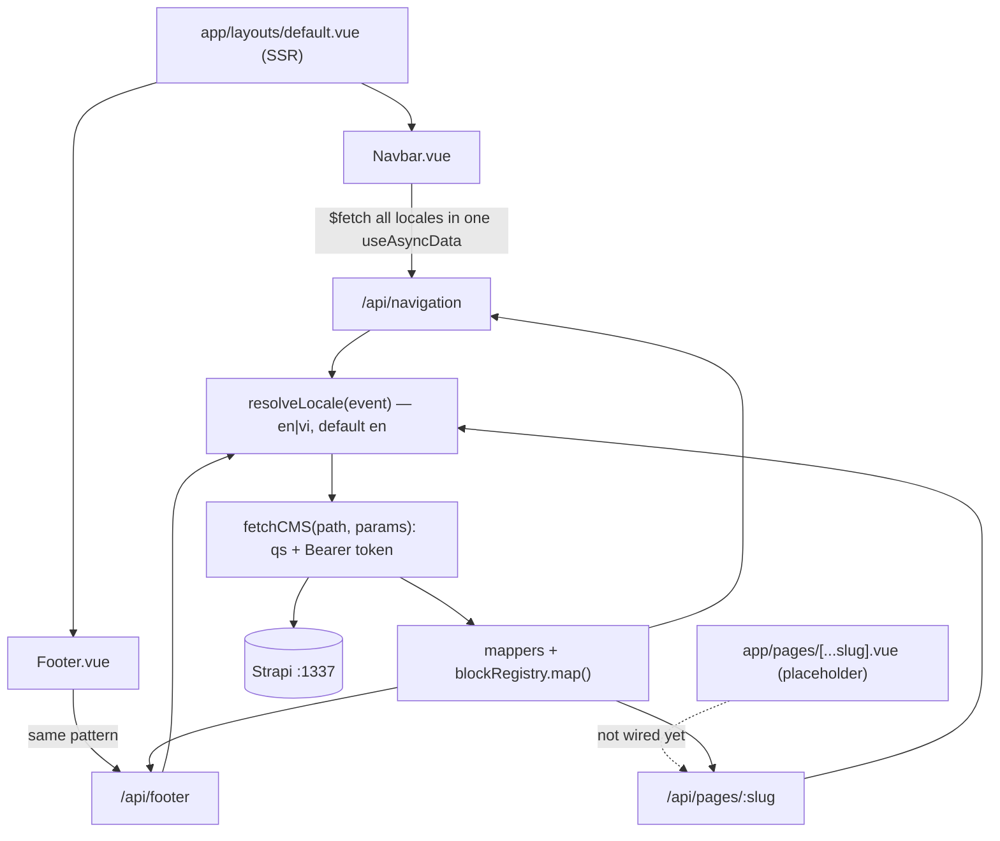

# Repository Guidelines

## Project Overview

Nuxt 4 SSR marketing site for **Serene Saigon** (private riverside club, Nhà Bè, HCMC). All copy and imagery come from a **Strapi CMS**; the Vue app never calls Strapi directly — it reads Nitro BFF routes under `/api/**` that translate Strapi's wire format into typed, render-ready models.

Two content shapes drive everything:

- **Singletons**: `header` → `/api/navigation`, `footer` → `/api/footer`.
- **Pages**: the `page.blocks` dynamic zone → `/api/pages/:slug`, mapped through a **block registry** into the discriminated union `PageBlock`.

Bilingual EN/VI: locale is a **content key** passed as `?locale=`, not an i18n message catalog — `$t()` is never called and no locale JSON files exist.

## Architecture & Data Flow



Invariants to preserve:

1. **The client never talks to Strapi.** Shaping lives in `server/utils`; a new CMS field must be mapped in a mapper or registry entry, then exposed on the route's exported response type.
2. **Locale is a query param.** `resolveLocale` accepts only `SUPPORTED_LOCALES` (`en|vi`) and falls back to `en`, so `?locale=fr` silently returns EN content (verified).
3. **Errors are terminal.** `handleStrapiError(err, ctx)` logs `[Strapi] <ctx>:` and throws `createError`; its `never` return type is what lets a handler declare `let res: StrapiX;` and use it after `try/catch` without definite-assignment errors. There is **no fallback or mock data** — Strapi down ⇒ 500 `Unable to fetch content`.
4. **Layout data is fetched once for all locales.** `Navbar.vue` / `Footer.vue` both run a top-level `await useAsyncData("navigation-all-locales" | "footer-all-locales")` that `Promise.all`s `$fetch("/api/...", { query: { locale: code } })` per locale into `Object.fromEntries`, then select with `computed(() => data.value?.[locale.value])` — switching language never refetches.
5. **Populate config is generated.** `blocksPopulate` is derived from `blockRegistry` and used as `populate.blocks` by `/api/pages/:slug`. An unregistered `__component` produces `console.warn("[pages] Unknown block: …")` and is dropped from the response.

## Key Directories

| Path | Purpose |
|---|---|
| `app/` | Vue UI (`~` / `@` alias → `app/`). `pages/[...slug].vue` is the only route, `layouts/default.vue` is Navbar + slot + Footer, components in `app/components/`. No `composables/`, `stores/`, `plugins/`, `middleware/`, or `app/assets/`. |
| `server/api/` | Nitro BFF: `navigation.get.ts`, `footer.get.ts`, `pages/[slug].get.ts` (single segment — `/api/pages/a/b` is 404). |
| `server/utils/` | `fetch-strapi.ts` (`fetchCMS`), `locale.ts` (`resolveLocale`, `SUPPORTED_LOCALES`), `mapper.ts` (media/link/background/menu-item mappers, `LinkType` re-export), `blocks.ts` (`blockRegistry`, `blocksPopulate`), `errors.ts`. |
| `server/types/` | `strapi.ts` = wire types (`Strapi*`, one per `__component`); `blocks.ts` = legacy shim re-exporting `../../types`. |
| `types/index.ts` | **Canonical shared client + server models** (`~~/types`). Root level — not `app/`, not Nuxt's `shared/`. |
| `assets/css/main.css` | Tailwind entry plus `@layer base` / `@layer utilities`. Root-level `assets/`, **not** `app/assets/`. |
| `tailwind.config.ts` | Design tokens: `cream`, `dark`, `primary`, `primary-hover`, `muted`, `warm-50…900`, `error*`, `max-w-container/content`, `tracking-label`, `shadow-card/dropdown/modal`, `animate-fade-in`. |
| `public/` | `favicon.ico`, `logo.jpg` (referenced as the head icon in `nuxt.config.ts`), `robots.txt`. |
| `docs/type.md` | Vietnamese TypeScript tutorial, unrelated to this app's API — not project documentation. |
| `temp/` | Gitignored raw design drop (`Serene Saigon.dc.html`); not built. |
| `.nuxt/`, `.output/`, `node_modules/` | Generated (gitignored). Never edit. |

## Development Commands

| Command | Notes |
|---|---|
| `bun install` | `postinstall` runs `nuxt prepare`, regenerating `.nuxt/tsconfig.*`. |
| `bun dev` | http://localhost:3000; auto-shifts to **3001** when 3000 is taken. |
| `bun build` | Nitro `node-server` preset → `.output/server/index.mjs`. |
| `bun generate` | Prerender. Prerendering is SSR, so each prerendered route runs the layout's `/api/navigation` + `/api/footer` fetches — expect a build-time Strapi dependency and no offline output `[INFERENCE]` (no fallback data exists anywhere). |
| `bun preview` | Serve the built output. |
| `bunx nuxt typecheck` | Only static gate wired up (strict vue-tsc). Currently exits 0. |
| `bunx vue-tsc --noEmit -p .nuxt/tsconfig.server.json` | Typecheck the Nitro half only (faster feedback). |

Strapi must run at `http://localhost:1337` (`runtimeConfig.strapiUrl`); the API token comes from `.env` → `NUXT_STRAPI_TOKEN` → `runtimeConfig.strapiToken` (server-only, never exposed to the client).

## Code Conventions & Common Patterns

No formatter, linter, or pre-commit hook exists — match the neighbouring code exactly: **2-space indent, double quotes, semicolons, trailing commas, ~80-column wrapping, Vietnamese inline comments.**

### Naming

- Route files follow Nitro/Nuxt convention (`footer.get.ts`); each handler also exports its own response type (`FooterResponse`, `NavigationResponse`, `PageResponse`).
- Wire types are `Strapi*` and carry the `__component: "block.x"` literal; client models are the mapped shape with a `type: "kebab-case"` discriminator, and closed sets become enums (`LinkType`, `BackgroundType`, `CtaVariant`, `ImagePositon`).
- Block keys are always `block.<kebab-case>`, matching Strapi.
- Comments/log prefixes: `[Strapi] <context>:`, `[pages] Unknown block: …`.

### Add a CMS block (three edits)

1. `types/index.ts` — client model, then extend the `PageBlock` union.
2. `server/types/strapi.ts` — `Strapi<Name>` with `__component: "block.<name>"`, then extend the `StrapiPageBlock` union.
3. `server/utils/blocks.ts` — registry entry: Strapi `populate` plus `map(block, strapiUrl)` returning `type: "<name>" as const`.

```ts
// server/utils/blocks.ts
"block.visit": {
  populate: { directionsCta: { populate: ["page"] }, mapImage: true },
  map: (b, strapiURL) => ({
    type: "visit" as const,
    id: b.id,
    eyebrow: b.eyebrow,
    directionsCta: b.directionsCta ? mapLink(b.directionsCta) : null,
    mapImage: b.mapImage ? mapMedia(b.mapImage, strapiURL) : null,
  }),
},
```

`blocksPopulate` rebuilds itself — never hand-edit `populate` in `/api/pages/[slug]`. `map` must be null-safe: every optional relation is guarded (`b.x ? mapLink(b.x) : null`) because Strapi omits unfilled components.

### Add an API endpoint

```ts
// server/api/<name>.get.ts
export default defineEventHandler(async (event): Promise<XResponse> => {
  const { strapiUrl } = useRuntimeConfig();
  const locale = resolveLocale(event);

  let res: StrapiX;
  try {
    res = (await fetchCMS<StrapiSingle<StrapiX>>("/x", { locale, populate: { … } })).data;
  } catch (err) {
    handleStrapiError(err, "GET /api/x/" + locale);
  }

  return { /* mapped, absolute media URLs via strapiUrl */ };
});
```

`fetchCMS` already appends `/api`, serializes params with `qs`, and sets the Bearer header — pass populate/filters/locale only.

### Rendering links

`mapLink` normalizes everything to `Link`, but `pageToPath()` returns `/{slug}` **without** a locale prefix (the prefixed form is commented out), and a missing page yields `to: "#"`. Components therefore branch on `LinkType` and push interior targets through `localePath()`:

```ts
const linkTag = (l: Link) => (l.type === LinkType.EXTERNAL ? "a" : NuxtLinkComp);
const linkProps = (l: Link) =>
  l.type === LinkType.EXTERNAL
    ? { href: l.to ?? "#", target: l.newTab ? "_blank" : undefined, rel: "noopener noreferrer" }
    : { to: (l.to ?? "#") === "#" ? "#" : localePath(l.to!) };
```

`Navbar.vue` additionally flattens the per-locale menu index (`flatten` + `documentId` matching) and uses `useSwitchLocalePath()` to find a page's counterpart in the other language.

### Media and styling

- `mapMedia(media, strapiUrl)` absolutizes relative Strapi URLs and defaults `alt` to `""`; render `width`/`height` when present.
- Prefer tokens over raw values: `bg-cream text-dark`, `text-primary` / `bg-primary-hover`, `font-sans`/`font-serif`, `max-w-container`, `tracking-label`, `shadow-card`, `class="fade"`.
- `letterSpacing.wide|wider|widest` are **overridden** with custom values — don't assume Tailwind defaults.
- Fonts `"Afacad Flux"` / `"Jost"` are declared in `tailwind.config.ts` and `main.css` but never loaded (no `@font-face`, no font module), so they currently fall back to the system stack.

### Known rough edges

- `server/types/blocks.ts` is a compatibility shim; the header comment says to import from `~/types`, but the real canonical path is `~~/types` (`~/types` would point at `app/types`, which does not exist).
- `ImagePositon` is a typo baked into the public API (`types/index.ts`) — keep the spelling unless migrating every usage.
- `runtimeConfig.public.strapiUrl` is currently dead config; only the server-side `strapiUrl` is read.
- `server/api/pages/[slug].get.ts` matches one segment only; nested slugs 404.
- Pinia is installed with **zero stores**, and `zod` is a dependency that is **never imported** — don't assume either is in use.

## Important Files

| File | Why it matters |
|---|---|
| `app/pages/[...slug].vue` | **Only route and still an unimplemented placeholder** (`<h1>hi</h1>` ×21). Replacing it with a real renderer for `/api/pages/:slug` blocks is the outstanding work. Every catch-all URL lands here; there is no `index.vue`, so `/` 302s to `/en` and renders the layout alone. |
| `app/components/Navbar.vue` (739 lines) | Largest file; owns locale switching, mobile drawer state, dropdown + flattened-menu logic. Read before touching navigation. |
| `app/components/Footer.vue` | Reference implementation of the all-locales fetch pattern and link rendering. |
| `server/utils/blocks.ts` | Block registry + generated `blocksPopulate` — the extension point for page content. |
| `server/utils/mapper.ts` | All wire → client translation. Add field mappings here, never in components. |
| `types/index.ts` | Single source of shared models and the `PageBlock` union. |
| `server/types/strapi.ts` | Exact Strapi field names/types; mirror CMS changes here first. |
| `nuxt.config.ts` | Modules, i18n prefix strategy, `runtimeConfig`, favicon. |
| `tailwind.config.ts` | Design tokens; `content` scans only `./app/**/*`, so styles in other directories won't be generated. |
| `.nuxt/tsconfig.*` | Generated project references: `~`/`@` → `app/`, `~~`/`@@` → repo root, `strict: true`. |
| `.env` (gitignored) | `NUXT_STRAPI_TOKEN` → `runtimeConfig.strapiToken`. |
| `CLAUDE.md` (gitignored) | Local-only assistant notes that already describe these patterns. |

## Runtime/Tooling Preferences

- **Bun is the mandated package manager** — only `bun.lock` exists (bun 1.4.2; no `packageManager`/`engines` field). The npm/pnpm/yarn instructions in `README.md` are untouched Nuxt boilerplate; ignore them. Node v22 is present and can run `.output/server/index.mjs`.
- Stack: Nuxt 4.5.2, Nitro 2.13.4, Vite 8.3.1, Vue 3.5.43, TypeScript strict, `vue-tsc` ^3.3.13. `@nuxtjs/i18n` is pinned exactly (`10.6.0`); Tailwind is **v3** via `@nuxtjs/tailwindcss` — not v4 CSS-first.
- Keep `nuxt.config.ts` minimal: there are no `nitro`, `routeRules`, `prerender`, `typescript`, `srcDir`, or `css` keys, `devtools` is disabled, and `compatibilityDate` is `2026-09-29`. Add configuration only when a feature requires it.
- Server code runs through Nitro auto-imports (`defineEventHandler`, `useRuntimeConfig`, `getQuery`, `createError` are not imported explicitly) — follow that style in `server/`.
- Import style is inconsistent but locally consistent: explicit `.ts` extensions for some `server/utils` imports, plain relative paths in `app/` (`../../types`), `~~/server/...` only in `pages/[slug].get.ts`.

## Testing & QA

- **There is no test framework, no spec/test file, no CI workflow, no git hook, and no lint/format configuration.** Don't invent infrastructure: the lockfile contains no vitest/jest/playwright/@nuxt/test-utils, `package.json` has no `test`/`lint`/`typecheck` script, and there is no `.github/`.
- Available gates: `bunx nuxt typecheck` (strict vue-tsc; catches undefined names and type errors across `app/**` and `server/**`), plus runtime smoke checks.
- Manual verification recipe (BFF + SSR end to end, requires Strapi on :1337 with a valid token):
  ```bash
  bun dev   # note the port if 3000 is busy
  curl 'http://localhost:3000/api/navigation?locale=en'      # 200; menuItems[].to like "/the-club"
  curl 'http://localhost:3000/api/footer?locale=vi'          # 200; localized address/columns
  curl 'http://localhost:3000/api/pages/the-club?locale=en'   # 200; blocks hero,intro,day-at,simple-section×7,visit
  curl -I 'http://localhost:3000/en/'                         # 200 SSR html; "/" → 302 /en
  ```
  Failure modes observed: Strapi down ⇒ 500 `Unable to fetch content`; unknown slug ⇒ 404 `Page not found`; `/api/pages/a/b` ⇒ 404.
- Check every content/rendering change in **both locales** — slugs differ per language (`/the-club` vs `/ve-serene`), and a scan of the dev log for `[pages] Unknown block:` is the cheapest regression check for registry drift.
- Empty `blocks: []` responses (`membership`, `club-events`, `private-event` at the time of writing) are **CMS data gaps, not frontend bugs** — fix them in Strapi, not here.
